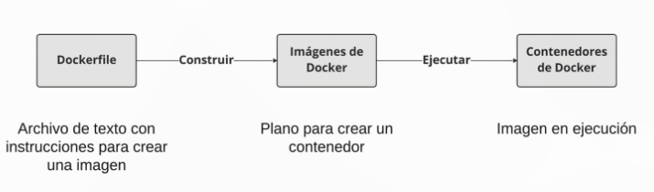

# Comandos de Docker

## 1. Comandos básicos

| Uso                               | Comando                     |
| --------------------------------- | --------------------------- |
| Iniciar un contenedor             | docker run (image-name)     |
| Iniciar un contenedor interactivo | docker run -it (image-name) |
| Iniciar en segundo plano          | docker run -d (image-name)  |
| Listar contenedores en ejecución  | docker ps                   |
| Listar todos los contenedores     | docker ps -a                |
| Detener un contenedor             | docker stop (image-name)    |

## 2. Comandos para trabajar con contenedores

| Uso                                        | Comando                                         |
| ------------------------------------------ | ----------------------------------------------- |
| Iniciar contenedor con nombre              | docker run --name (container-name) (image-name) |
| Filtrar contenedor en ejecución por nombre | docker ps -f "name=(container-name)"            |
| Ver registros existentes del contenedor    | docker logs (container-id)                      |
| Ver registros en vivo del contenedor       | docker logs -f (container-id)                   |
| Salir de vista de registro en vivo         | CTRL + C                                        |
| Eliminar contenedor detenido               | docker container rm (container-id)              |

## 3. Comandos para gestionar imágenes locales

| Uso                                       | Comando                                  |
| ----------------------------------------- | ---------------------------------------- |
| Descargar una imagen                      | docker pull (image-name)                 |
| Descargar una versión específica          | docker pull (image-name):(image-version) |
| Listar todas las imagágenes locales       | docker images                            |
| Eliminar una imagen                       | docker image rm (image-name)             |
| Eliminar todos los contenedores detenidos | docker container prune                   |
| Eliminar todas las imágenes               | docker image prune -a                    |

## 4. Distribución de imágenes

| Uso                                     | Comando                                         |
| --------------------------------------- | ----------------------------------------------- |
| Descargar imagen de un registro privado | docker pull (private-registry-url)/(image-name) |
| Renombrar una imagen                    | docker tag (old-name) (new-name)                |
| Subir una imagen                        | docker image push (image-name)                  |
| Iniciar sesión en registro privado      | docker login (private-registry-url)             |
| Guardar imagen a archivo                | docker save -o (file-name) (image-name)         |
| Cargar imagen desde archivo             | docker load -i (file-name)                      |

## 5. Creación de imágenes



### 5.1 Iniciar Dockerfile

```dockerfile
FROM postgres
FROM ubuntu
FROM hello-world
FROM my-custom-data-pipeline
```

```dockerfile
FROM postgres:15.0
FROM ubuntu:22.04
FROM hello-world:latest
FROM my-custom-data-pipeline:v1
```

### 5.2 Crear Dockerfile

Crear un Dockerfile genera una imagen.

docker build /location/to/Dockerfile
docker build .

### 5.3 Nombrar la imagen

docker build -t first_image .

docker build -t first_image_v0 .

### 5.4 Personalizar imágenes

Se usa la -y para evitar prompts.

```dockerfile
RUN (valid-shell-command)
FROM ubuntu
RUN apt-get update
RUN apt-get install -y python3
```

### 5.5 Resumen

| Uso                                     | Comando                        |
| --------------------------------------- | ------------------------------ |
| Empezar un Dockerfile desde una imagen  | FROM (image-name)              |
| Añadir un comando de shell a la imagen  | RUN (valid-shell-command)      |
| Asegura que no pida entrada del usuario | RUN apt-get install -y python3 |

| Uso                                  | Comando de shell                     |
| ------------------------------------ | ------------------------------------ |
| Crear imagen desde Dockerfile        | docker build /location/to/Dockerfile |
| Crear imagen en el directorio actual | docker build .                       |
| Elegir nombre al crear una imagen    | docker build -t first_image          |

## 6. Gestionar arcivo en una imagen

### 6.1 Copiar archivos a una imagen

```dockerfile
COPY (src-path-on-host) (dest-path-on-image)
COPY /projects/pipeline_v3/pipeline.py /app/pipeline.py
```

Si no indicas un nombre de archivo en src, se copiará todo el contenido. Comandos para copiar archivos o carpetas del host a la imagen.

```dockerfile
COPY (src-path-on-host) (dest-path-on-image)
COPY (src-folder) (dest-folder)
COPY /projects/pipeline_v3/pipeline.py /app/
```

### 6.2 Descargar archivos

En lugar de copiar desde un directorio local, a menudo se descargan archivos durante el build de la imagen:

- Descargar un archivo

```dockerfile
RUN curl (file-url) -o (destination)
```

- Descomprimir el archivo

```dockerfile
RUN unzip (dest-folder)/(filename).zip
```

- Borrar el zip original

```dockerfile
RUN rm (copy_directory)/(filename).zip
```

### 6.3 Descargar archivos de manera eficiente

```dockerfile
RUN curl (file-url) -o (destination_directory)/(filename).zip \
&& unzip (destination_directory)/(filename).zip -d (unzipped-directory) \
&& rm (destination_directory)/(filename).zip
```
