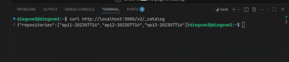
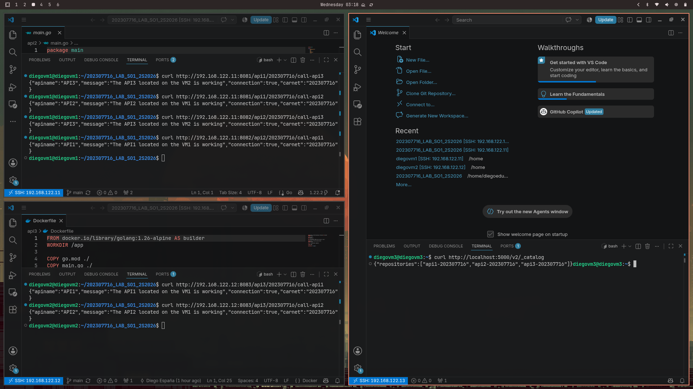
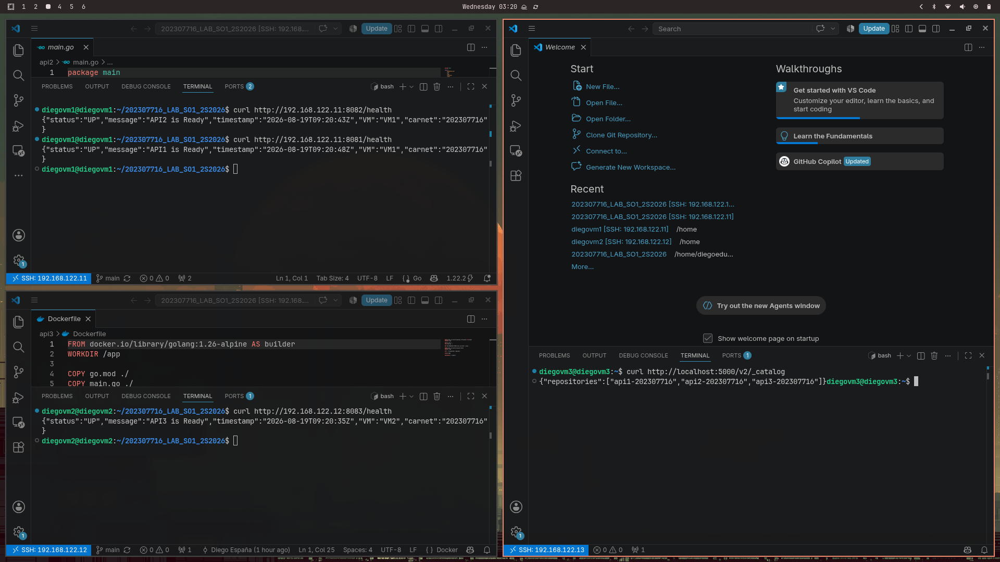
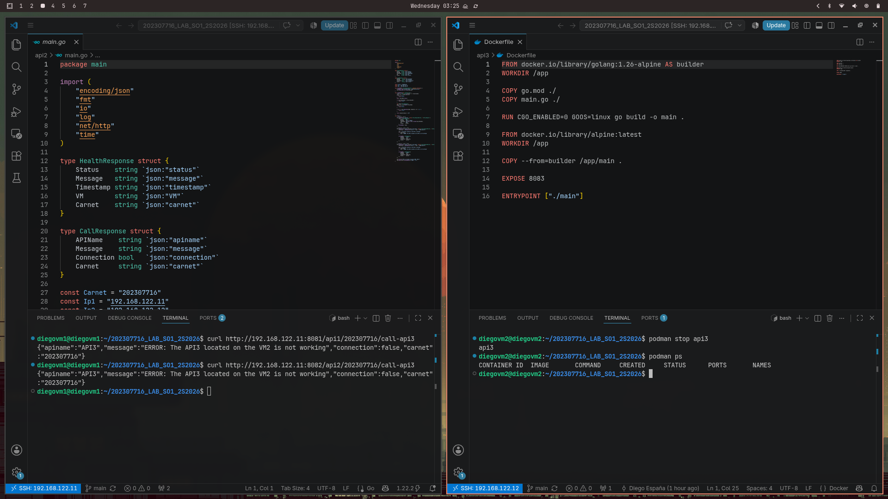
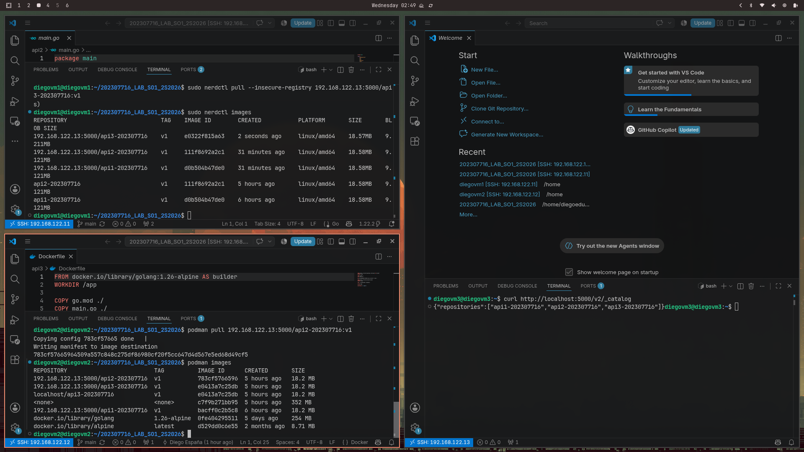
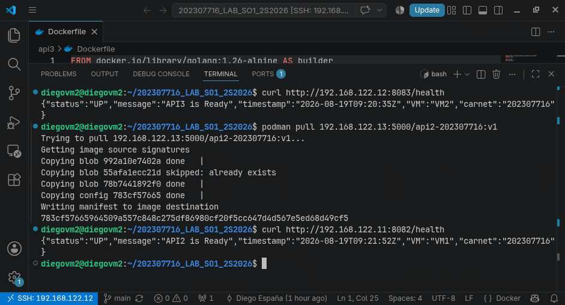
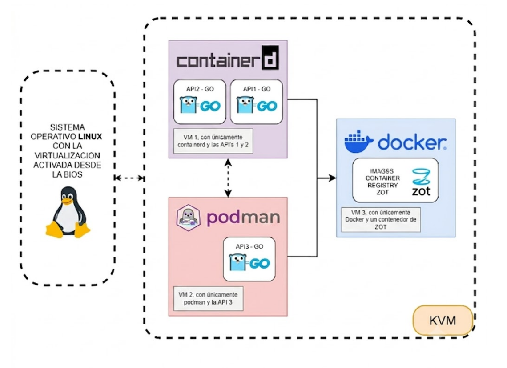

# Proyecto 1 - Sistemas Operativos 1

| Nombre                       | Carnet    |
|--------                      | -------   |
| Diego Eduardo España Vásquez | 202307716 |

## 1. Instalación de Virt-Manager

Instalación de Virt-Manger para administrar las VMs de manera sencilla mediante una interfaz gráfica.

```bash
# Instalación de paquetes
sudo pacman -S qemu-full virt-manager libvirt dmidecode openbsd-netcat
```

- ``qemu-full``: Emulador y motor de virtualización.
- ``virt-manager``: Interfaz gráfica para gestionar VMs.
- ``libvirt``: Herramienta para controlar VMs en segundo plano.
- ``dmidecode``: Lector de datos de la BIOs.
- ``openbsd-netcat``: Comunicación entre virt-manager y libvirt.

```bash
# Habilitar servicio de libvirtd
sudo systemctl enable --now libvirtd

# Verificar que esté corriendolibvirtd
sudo systemctl status libvirtd

# Agregar usuario al grupo de libvirt para no usar sudo
sudo usermod -aG libvirt $USER

# Activar red NAT
sudo virsh net-start default

# Configurar red NAT para que se reinicie automáticamente
sudo virsh net-autostart default

# Permitir tráfico en la interfaz de la red por defecto de KVM
sudo ufw route allow in on virbr0
sudo ufw allow in on virbr0 to any port 67 proto udp
sudo ufw allow in on virbr0 to any port 53

# Confirmar subred que utiliza
virsh net-dumpxml default | grep -A2 '<ip'
```

### 1.1 Comandos para ver estado de máquinas virtuales

```bash
virsh list --all           # Lista todas las VMs
virsh start <nombre>       # Inicia una VM
virsh shutdown <nombre>    # Apaga una VM
```

## 2. Creación de VMs

Luego de instalar virt-manager, hay que descargar la ISO de Ubuntu Server 24.04.4. Luego para crear las máquinas virtuales fueron necesarios los siquientes pasos:

- **Crear una nueva VM:** Haz clic en el ícono de "Monitor con estrella", seleccionar "Medio de instalación local" y presionar botón de "Siguiente".
- **Elegir ISO:** Seleccionar la ISO de la ubicación donde la hayamos descargado.
- **Elegir memoria y CPU:** Para este proyecto es necesario 2048 de memoria para cada VM y 2 CPUs.
- **Espacio en disco:** Otorgar 10GB para cada VM.
- **Nombre:** Ponerle nombre a cada VM, en este caso el nombre seleccionado fue VM seguido del número al que corresponde cada máquina virtual.

## 3. Ping entre VM

En cada una de la VM es necesario instalar los paquetes para poder hacer ping entre ellas.

```bash
# Actualizar paquetes del sistema
sudo apt update

# Instalar paquetes de ping
sudo apt install iputils-ping

# Hacemos ping con la ip de red para verificar su instalación
ping -c 5 192.168.122.1
```

### 3.1 Ping VM1

```bash
# Ping a VM2
ping -c 5 192.168.122.12

# Ping a VM3
ping -c 5 192.168.122.13
```

### 3.2 Ping VM2

```bash
# Ping a VM1
ping -c 5 192.168.122.11

# Ping a VM3
ping -c 5 192.168.122.13
```

### 3.3 Ping VM3

```bash
# Ping a VM1
ping -c 5 192.168.122.11

# Ping a VM2
ping -c 5 192.168.122.12
```

## 4. Instalación de Containerd, Nerdctl y CNI en VM1

Para instalar Containerd seguí los pasos del repositorio brindado por el auxiliar [Containerd](https://github.com/JoseLorenzana272/sopes1_ejemplos/tree/main/Semana2/proyecto1-ejemplo).

```bash
# Actualizar paquetes del sistema
sudo apt-get update

# Instalar paquete oficial de containerd
sudo apt-get install -y containerd

# Verificar versión instalada
containerd --version
```

Luego de tener instalado containerd instalé nerdctl con los comandos del blog del ingeniero [Nerdctl_CNI](https://dev.to/sergioarmgpl/running-containerd-on-arm-575c).

```bash
# Actualizar paquetes del sistema
sudo apt-get update

# Instalar pversión full nerdctl que incluye las dependencias necesarias como CNI
wget https://github.com/containerd/nerdctl/releases/download/v2.0.3/nerdctl-full-2.0.3-linux-amd64.tar.gz

# Extracción de archivo en /usr/local
sudo tar -C /usr/local -xzvf nerdctl-full-2.0.3-linux-amd64.tar.gz

# Verificar versión instalada
nerdctl --version

# Primer conteneder de NGINX en el puerto 8080
sudo nerdctl run --restart always -d -p 8080:80 --name=nginx nginx

# Probar contenedor
curl localhost:8080

# Eliminar contenedor
sudo nerdctl rm -f nginx
```

## 5. Instalación de Podman en VM2

Para instalar podman se hizo de la manera tradicional en Ubuntu.

```bash
# Actualizar paquetes del sistema
sudo apt update

# Instalar Podman
sudo apt install -y podman

# Verificar versión instalada
podman --version

# Primer contenedor de NGINX en el puerto 8080
podman run -d --name nginx -p 8080:80 nginx

# Eliminar contenedor
podman rm nginx
```

## 6. Instalación de Docker en VM3

Para que la instalación fuera más sencilla utilicé el script de instalación de la página oficial de Docker, el cual se encargó de instalar todas las dependencias necesarias y configurar paquetes del sistema para que Docker funcione correctamente.

```bash
# Comando para instalación automática
curl -fsSL https://get.docker.com -o get-docker.sh && sudo sh get-docker.sh

# Verificar versión instalada
docker --version

# Levantar primer contenedor
sudo docker run hello-world

# Eliminar contenedor
sudo docker rm hello-world
```

Para no ejecutar todos los comandos de docker con "sudo" antes de cada comando fue necesario hacer lo siguiente.

```bash
# Agregar usuario al grupo docker
sudo adduser diegovm3 docker

# Reiniciar paquetes del sistema
sudo reboot
```

## 7. Construcción de imagenes en VM1 y VM2

### 7.1 VM1

```bash
# Clonar repositorio
git clone https://github.com/DiegoEdueEntrar en la carpeta de API 1
cd# Contruir contenedor
sudo nerdctl build -t api1-202307716:v1 .

# Entrar en la carpeta de API 2
cd ../api2

# Consstruir contenedor
sudo nerdctl build -t api2-202307716:v1 .

# Verificar que ambas imágenes existan
sudo nerdctl images
```

### 7.2 VM2

```bash
# Clonar repositorio
git clone https://github.com/DiegoEdueEntrar en la carpeta de API 3
cd# Contruir contenedor
podman build -t api3-202307716:v1 .

# Verificar que la imagen exista
podman images
```

## 8. Correr los contenedores de manera local en VM1 y VM2

### 8.1 VM1

```bash
# Activación de buildkit.service
sudo cp /usr/local/lib/systemd/system/buildkit.service /etc/systemd/system/
sudo systemctl daemon-reload
sudo systemctl enable --now buildkit
sudo systemctl status buildkit

# Correr en segundo plano, con el nombre api1, en el puerto 8081 y reinicio automático
sudo nerdctl run -d --name api1 -p 8081:8081 --restart always api1-202307716:v1

# Correr en segundo plano, con el nombre api1, en el puerto 8081 y reinicio automático
sudo nerdctl run -d --name api2 -p 8082:8082 --restart always api2-202307716:v1

# Listar los contenedores que están corriendo
sudo nerdctl ps
```

### 8.2 VM2

```bash
# Correr en segundo plano, con el nombre api1, en el puerto 8081 y reinicio automático
podman run -d --name api3 -p 8083:8083 --restart always api3-202307716:v1

# Listar contenedor corriendo
podman ps
```

## 9. Prueba local de estado

### 9.1 VM1

```bash
# Comando para probar api1
curl localhost:8081/health

# Comando para probar api2
curl localhost:8082/health
```

### 9.2 VM2

```bash
# Comando para probar api3
curl localhost:8083/
```

## 10. Expasión de de espacio en disco

Luego de crear los contenedores y correrlos, la memoria asignada en un principio se quedó corta. Entonces fue necesario añadir más a la VM1 y VM3.

### 10.1 VM1

```bash
# Apaga la VM
sudo virsh shutdown vm1

# Verificar que esté apagada
sudo virsh list --all

# Expande el disco qcow2
sudo qemu-img resize /var/lib/libvirt/images/VM1.qcow2 +3G

# Encender la VM
sudo virsh start vm1
```

### 10.2 VM3

```bash
# Apaga la VM
sudo virsh shutdown vm3

# Verificar que esté apagada
sudo virsh list --all

# Expande el disco qcow2
sudo qemu-img resize /var/lib/libvirt/images/VM3.qcow2 +7G

# Encender la VM
sudo virsh start vm3
```

### 10.3 Expansión de partición y reonocimiento de filesystem

Este procedimiento se debe de realizar dentr de cada una de las VMs que se les exapandió el espacio en disco.

```bash
# Confirma que el disco ya creció a nivel de bloque
sudo lsblk

# Expandir la partición física
sudo growpart /dev/vda 3

# Expandir el physical volume de LVM
sudo pvresize /dev/vda3

# Expandir el logical volume para usar todo el espacio libre
sudo lvextend -l +100%FREE /dev/mapper/ubuntu--vg-ubuntu--lv

# Expandir el filesystem (ext4) para ocupar el nuevo tamaño del LV
sudo resize2fs /dev/mapper/ubuntu--vg-ubuntu--lv

# Verifica
df -h
```

## 11. Comunicación entre API1 y API2

```bash
# Comando para que api1 llame a api2
curl localhost:8081/api1/202307716/call-api2

# Comando para que api2 llame a api1
curl localhost:8082/api2/202307716/call-api1
```

## 12. Instalación y configuración de Zot en VM3

Crear directorio para persistencia de datos.

```bash
mkdir -p ~/zot/data             
```

Ejecutar el siguiente comando para iniciar un registro Zot en segundo plano, exponiendo el puerto 5000, con nombre zot, reinicio automático y creación de un volumen para persistir los datos.

```bash
docker run -d -p 5000:5000 -v ~/zot/data:/var/lib/registry --restart always --name zot ghcr.io/project-zotzot-linux-amd64:latest
```

### 12.1 Configuración de Docker en Host

Editar configuración de Docker:

```bash
sudo nano /etc/docker/daemon.json
```

Agregar el conteniedo del archivo:

```bash
{
    "insecure-registries": ["192.168.122.13:5000"]
}
```

Reiniciar Docker para aplicar los cambios:

```bash
sudo systemctl restart docker
```

## 13. Push de imágenes de VM1 y VM2 hacia el registro Zot en VM3

### 13.1 VM1 con Containerd + nerdctl

Etiquetar la imagen para el registro privado:

```bash
# API1
sudo nerdctl tag api1-202307716:v1 192.168.122.13:5000/api1-202307716:v1

# API2
sudo nerdctl tag api2-202307716:v1 192.168.122.13:5000/api2-202307716:v1
```

Subir la imagen al registro Zot con bandera para permitir registro inseguro:

```bash
# Push API1
sudo nerdctl push --insecure-registry 192.168.122.13:5000/api1-202307716:v1

# Push API2
sudo nerdctl push --insecure-registry 192.168.122.13:5000/api1-202307716:v1
```

### 13.2 VM2 con Podman

Etiquetar la imagen para el registro privado:

```bash
# API3
podman tag api3-202307716:v1 192.168.122.13:5000/api3-202307716:v1

# Configuración de registro como inseguro
sudo tee -a /etc/containers/registries.conf << 'EOF'

[[registry]]
location = "192.168.122.13:5000"
insecure = true
EOF
```

Subir la imagen al registro Zot:

```bash
# Push API1
podman push 192.168.122.13:5000/api3-202307716:v1
```

### 13.3 Verificación de cátalogo de Zot

Ejecutar el siguiente comando desde cualquier VM o incluso desde el Host:

```bash
curl http://192.168.122.13:5000/v2/_catalog
```

Si los contenedores se subieron a Zot deben de listarse como en la siguiente imagen:



## 14. Evidencias

Probar los siguientes comandos desde el host o cualquier vm que tenga la imagen y el contenedor corriendo:

```bash
curl http://192.168.122.11:8081/api1/202307716/call-api2
curl http://192.168.122.11:8081/api1/202307716/call-api3
curl http://192.168.122.11:8082/api2/202307716/call-api1
curl http://192.168.122.11:8082/api2/202307716/call-api3
curl http://192.168.122.12:8083/api3/202307716/call-api1
curl http://192.168.122.12:8083/api3/202307716/call-api2
```



Comandos para verificar el estado de cda VM:

```bash
curl http://192.168.122.11:8081/api1/health
curl http://192.168.122.11:8082/api2/health
curl http://192.168.122.12:8083/api3/health
```



Comandos para verificar errores:

```bash
# En VM2
podman stop api3

# Desde VM1
curl http://192.168.122.11:8081/api1/202307716/call-api3

# Volver a levantar el contenedor
podman start api3
```



Hacemos pull de las imágenes en VM1:

```bash
# Pull en VM1 de API3
sudo nerdctl pull 192.168.122.13:5000/api3-202307716:v1

# Listar imágenes
sudo nerdctl images
```

Hacemos pull de las imágenes en VM2:

```bash
# Pull en VM2 de API1
podman pull 192.168.122.13:5000/api1-202307716:v1

# Pull en VM2 de API2
podman pull 192.168.122.13:5000/api2-202307716:v1

# Listar imágenes
podman images
```



Comprobar que la imagen funciona en la VM2.

```bash
# Pull en VM2 de API1
podman pull 192.168.122.13:5000/api2-202307716:v1

# Vemos el estado
curl http://192.168.122.11:8082/api2/health
```



## 15. Diagrama de arquitectura


