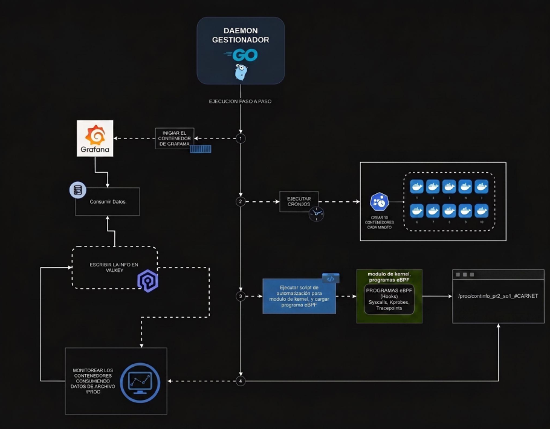

# Documentación Técnica

## 1. Resumen

El sistema vigila un conjunto de contenedores Docker de prueba, decide de forma autónoma cuáles mantener y cuáles eliminar según reglas de consumo de recursos, y audita a nivel de kernel que cada eliminación decidida realmente ocurrió, antes de darla por confirmada. Todo el estado se visualiza en un dashboard de Grafana en tiempo real.

Componentes:

| Componente       | Responsabilidad                                                      | Tecnología     |
| ---------------- | -------------------------------------------------------------------- | -------------- |
| Módulo de kernel | RAM total/libre/uso + detalle de procesos y contenedores vía `/proc` | C              |
| Cronjob          | Despliega 5 contenedores aleatorios cada 1 min                       | Bash + crontab |
| Sonda eBPF       | Audita la syscall `kill()` y confirma terminaciones reales           | eBPF (C)       |
| Daemon           | Orquesta todo: cronjob, decisión, eliminación, métricas              | Go             |
| Valkey           | Almacena métricas y contadores                                       | Valkey         |
| Grafana          | Dashboard en tiempo real                                             | Grafana        |

---

## 2. Arquitectura y flujo de una eliminación



1. El daemon lee `/proc/continfo_pr2_so1_202307716` cada 30s.
2. Agrupa procesos por contenedor y aplica la política de decisión [Sección 5](#5-daemon-go--política-de-decisión).
3. Para cada contenedor a eliminar, obtiene su PID de host (`docker inspect -f '{{.State.Pid}}'`) y envía la señal **directamente** con `syscall.Kill()` nunca vía `docker kill`, para que la sonda eBPF atribuya el `kill()` al propio daemon y no a `dockerd`.
4. La sonda eBPF, enganchada al tracepoint `syscalls/sys_enter_kill`, captura el evento (PID emisor, PID receptor, señal) y lo envía al daemon vía un ring buffer.
5. Solo cuando llega esa confirmación, el daemon hace `docker rm -f` y registra la eliminación en Valkey.

---

## 3. Estructura del repositorio

```bash
Proyecto2/
├── daemon/
│   ├── go.mod / go.sum
│   ├── main.go                           # daemon
│   ├── ebpf_kill.c                       # programa eBPF
│   └── proyecto2-daemon.service.template # unidad systemd
├── grafana-valkey/
│   ├── docker-compose.yml
│   ├── Dockerfile                        # build de Grafana con el plugin ya instalado
│   └── provisioning/
│       ├── datasources/valkey.yaml
│       └── dashboards/
│           ├── dashboard.yaml            # provider
│           └── json/dashboard.json       # dashboard exportado de Grafana
├── modulo/
│   ├── continfo_pr2_so1_202307716.c
│   ├── Makefile
│   └── README.md
└── scripts/
    ├── start.sh / stop.sh                # orquestan todo el pipeline
    ├── cargar_modulo.sh / descargar_modulo.sh
    ├── cronjob.sh                        # el que ejecuta cron cada 1 min
    └── Dockerfile / intruso.sh           # imagen intrusa
```

---

## 4. Módulo de kernel

Expone un único archivo en `/proc` con RAM y el listado de procesos.

**RAM:**

```json
{"TotalRAM_KB": ..., "FreeRAM_KB": ..., "UsedRAM_KB": ...}
```

**Por proceso:** `PID`, `Name`, `VSZ_KB`, `RSS_KB`, `Memory_Usage`, `CPU_Usage`, y `Cmdline` o bien `ContainerID`.

**Detalles de implementación importantes:**

- Recorre `for_each_process()` dentro de `rcu_read_lock()`/`unlock()`, necesario porque contenedores nacen y mueren cada 1 min y un proceso podría desaparecer a mitad de la iteración.
- Todo string que se imprime en el JSON (`Name`, `Cmdline`, `ContainerID`) pasa por `seq_print_json_escaped()`, que escapa comillas, backslashes y caracteres de control. Sin esto, cualquier proceso del sistema con uno de esos caracteres en su cmdline rompe el JSON completo.
- `CPU_Usage` se calcula como `(utime+stime) / jiffies_totales_del_sistema`, no desde el arranque del proceso.

---

## 5. Daemon

Vive completo en `daemon/main.go`.

**Restricciones que aplica (`decide()`):**

- Siempre quedan activos **mínimo 3** contenedores `perfil=bajo` y **mínimo 2** `perfil=alto`.
- Los contenedores `perfil=intruso` se eliminan **siempre** que se detectan.
- El contenedor de Grafana nunca es candidato: no lleva el label `perfil`, así que ni siquiera entra en la lista que evalúa el daemon.
- Entre los que exceden el mínimo, se eliminan primero los de **mayor** consumo.

**Responsabilidades del `main()`:**

1. Levanta Grafana/Valkey (`docker compose up -d`).
2. Instala el cronjob en el crontab de **root** con **ruta absoluta**, resuelta en tiempo de ejecución con `filepath.Abs()`. Una ruta relativa aquí falla en silencio, porque cron no hereda el `WorkingDirectory` del daemon.
3. El módulo de kernel se carga con `make load`.
4. Loop principal cada 30s: lee `/proc`, guarda métricas en Valkey, decide y dispara eliminaciones.
5. Al recibir SIGINT/SIGTERM: retira el cronjob antes de salir.

---

## 6. Sonda eBPF

`ebpf_kill.c` se engancha al tracepoint `syscalls/sys_enter_kill`. Captura:

- `sender_pid`: quien invocó `kill()` debe ser el PID del propio daemon.
- `target_pid`: el PID destino (`ctx->args[0]`).
- `signal`: la señal enviada (`ctx->args[1]`).

Se compila con `bpf2go`, que genera `ebpfkill_bpfel.go` con los bindings de Go. Requiere `vmlinux.h`, generado con `bpftool` en la misma máquina.

El daemon lee los eventos de un ring buffer en una goroutine separada (`watchEBPFEvents`), que corre independiente del loop principal por eso el contador de eventos eBPF sigue subiendo aunque el `Tick()` esté fallando por otro motivo.

---

## 7. Esquema de datos en Valkey

| Llave                                 | Tipo       | Contenido                                     |
| ------------------------------------- | ---------- | --------------------------------------------- |
| `ram:total` / `ram:free` / `ram:used` | string     | Snapshot de RAM actual, en KB                 |
| `ram:history`                         | sorted set | Serie de tiempo de RAM usada                  |
| `top:ram` / `top:cpu`                 | sorted set | Última lectura de consumo por contenedor      |
| `containers:deleted:count`            | contador   | Total de contenedores eliminados              |
| `containers:deleted:history`          | sorted set | Historial de eliminaciones en el tiempo       |
| `ebpf:events:count`                   | contador   | Total de eventos capturados por la sonda eBPF |

---

## 8. Dashboard de Grafana

7 paneles, provisionados automáticamente desde `grafana-valkey/provisioning/dashboards/json/dashboard.json` si se realiza un cambio al dashboard es necesario copiar el json generado en grafana, ya que dicho cambio no se subirá al repositorio remoto porque el gitignore ignora la data de grafana:

- **Total RAM / Free RAM / Total Contenedores Eliminados**: tarjetas `stat`, query type `CLI` (`GET <llave>`).
- **Gráfica de Uso de RAM en el Tiempo**: panel `timeseries`, query type `Command` → `zrange` sobre `ram:history`.
- **Top 5 por RAM / CPU**: `piechart`, query type `Command` → `zrange` sobre `top:ram` / `top:cpu`, con `start`/`end` como **string**, no número.
- **eBPF Event Counter**: `stat`, `CLI` sobre `ebpf:events:count`.

---

## 9. Instalación

```bash
scripts/start.sh
```

Automatiza, saltando lo que ya esté hecho: carga del módulo, build de la imagen intrusa, generación de la sonda eBPF, compilación del daemon, `docker compose up`, e instalación del servicio systemd.

```bash
scripts/stop.sh
```

Detiene el daemon, limpia el cronjob, elimina los contenedores gestionados, baja Grafana/Valkey, y descarga el módulo de kernel.
