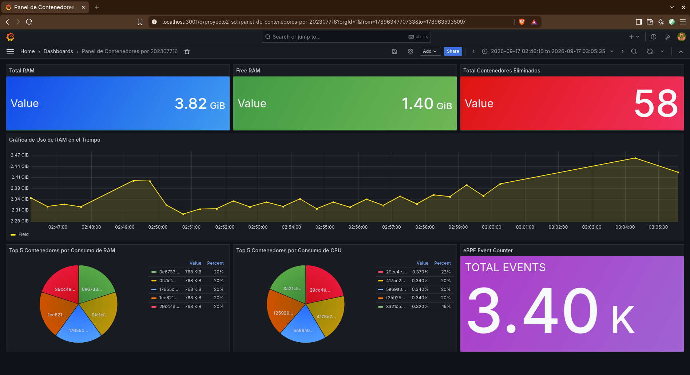

# Proyecto 2 - Sistemas Operativos 1

## 1. Instalación de Virt-Manager

Instalación de Virt-Manger para administrar las VMs de manera sencilla mediante una interfaz gráfica.

```bash
# Instalación de paquetes
sudo pacman -S qemu-full virt-manager libvirt dmidecode openbsd-netcat
```

- ``qemu-full``: Emulador y motor de virtualización.
- ``virt-manager``: Interfaz gráfica para gestionar VMs.
- ``libvirt``: Herramienta para controlar VMs en segundo plano.
- ``dmidecode``: Lector de datos de la BIOs.
- ``openbsd-netcat``: Comunicación entre virt-manager y libvirt.

```bash
# Habilitar servicio de libvirtd
sudo systemctl enable --now libvirtd

# Verificar que esté corriendolibvirtd
sudo systemctl status libvirtd

# Agregar usuario al grupo de libvirt para no usar sudo
sudo usermod -aG libvirt $USER

# Activar red NAT
sudo virsh net-start default

# Configurar red NAT para que se reinicie automáticamente
sudo virsh net-autostart default

# Permitir tráfico en la interfaz de la red por defecto de KVM
sudo ufw route allow in on virbr0
sudo ufw allow in on virbr0 to any port 67 proto udp
sudo ufw allow in on virbr0 to any port 53

# Confirmar subred que utiliza
virsh net-dumpxml default | grep -A2 '<ip'
```

### 1.1 Comandos para ver estado de máquinas virtuales

```bash
virsh list --all           # Lista todas las VMs
virsh start <nombre>       # Inicia una VM
virsh shutdown <nombre>    # Apaga una VM
```

## 2. Creación de VMs

Luego de instalar virt-manager, hay que descargar la ISO de Ubuntu Server 24.04.4. Luego para crear las máquinas virtuales fueron necesarios los siquientes pasos:

- **Crear una nueva VM:** Haz clic en el ícono de "Monitor con estrella", seleccionar "Medio de instalación local" y presionar botón de "Siguiente".
- **Elegir ISO:** Seleccionar la ISO de la ubicación donde la hayamos descargado.
- **Elegir memoria y CPU:** Para este proyecto es necesario 4096 de memoria para la VM y 4 CPUs.
- **Espacio en disco:** Otorgar 12GB para la VM.
- **Nombre:** Ponerle nombre a la VM, en este caso el nombre seleccionado fue diego.

## 3. Requisitos previos

Asegurate de tener las siguientes tecnologías instaladas, para que el proyecto pueda funcionar correctamente.

### 3.1. Golang

```bash
sudo apt update
sudo apt install golang-go -y
```

### 3.2. Docker

```bash
# Comando para instalación automática
curl -fsSL https://get.docker.com -o get-docker.sh && sudo sh get-docker.sh

# Verificar versión instalada
docker --version

# Levantar primer contenedor
sudo docker run hello-world

# Eliminar contenedor
sudo docker rm hello-world
```

Para no ejecutar todos los comandos de docker con "sudo" antes de cada comando fue necesario hacer lo siguiente.

```bash
# Agregar usuario al grupo docker
sudo adduser diego docker

# Reiniciar paquetes del sistema
sudo reboot
```

### 3.3. Cron

El servicio de tareas programadas `cron` es obligatorio para la creación automática de contenedores.

```bash
sudo apt install -y cron
sudo systemctl enable cron
sudo systemctl start cron
```

### 3.4 Módulo de Kernel

- Instalar herramientas de compilación.

```bash
sudo apt-get update
sudo apt-get install build-essential
```

- Instalar headers del kernel.

```bash
sudo apt-get update
sudo apt-get install linux-headers-$(uname -r)
```

### 3.5 Sonda eBPF

- Instalar dependencias.

```bash
sudo apt-get update
sudo apt-get install -y llvm clang
sudo apt-get install -y libbpf-dev libbpf
```

## 4. Inicio del proyecto

Una vez instalado todo desde la raíz del proyecto o bien desde la carpeta scripts debes ejecutar el script `start.sh` de esta manera se iniciará todo lo necesario para que el proyecto funcione.

Si deseas cerrar todo solo es necesario que ejecutes el script `stop.sh`. De esta manera los contenedores se eliminarán, el daemon dejará de funcionar y el módulo de kernel se descargará.

```bash
# Ejecutar scripts desde la raíz del proyecto
./scripts/start.sh
./scripts/stop.sh

# Ejecutar scripts dentro de la carpeta de scripts
cd scripts
./start.sh
./stop.sh
```

## 5. Dashboard de Grafana

Puedes comenzar a ver el resultado del sistema directamente en la web. Una vez ya hayas iniciado todo el proyecto.

1. Abre tu navegador y dirígete a `http://localhost:3001` o `http://192.168.122.14:3001`.
2. Inicia sesión con la cuenta de administrador inicial:
   - **Usuario:** admin
   - **Contraseña:** admin
3. Dentro, acude al apartado "Dashboards".
4. Luego selecciona el dashboard correcto.
5. Verás las estadísticas que se muestran en paneles como:
   - **Medidores Resumen:** Memoria de RAM total de tu disco, la memoria RAM libre, el total de contenedores eliminados y contador de los eventos realizados por eBPF.
   - **Gráficos de pie:** Top 5 conetedores por consumo de RAM y top 5 contenedores por consumo de CPU.
   - **Gráfica de tiempo:** Muestra el uso de RAM en el tiempo.


